# Tagda Timer

A modern WCA speedcubing timer. Official random-state scrambles for every WCA event,
real competition inspection, trainers with per-case stats, an alg trainer for seven
puzzles, a reconstruction workbench for CFOP and Roux, Competition Mode for timed
averages, webcam replay with video export, live race rooms with random 1v1, a daily
scramble with a leaderboard, chat and shared replays, and a theme engine that lets you
rebuild the entire look. In English or Spanish, on a desktop or a phone.

**Live at [tagdatimer.me](https://tagdatimer.me/)** · built by
[@cubingngagng](https://instagram.com/cubingngagng)

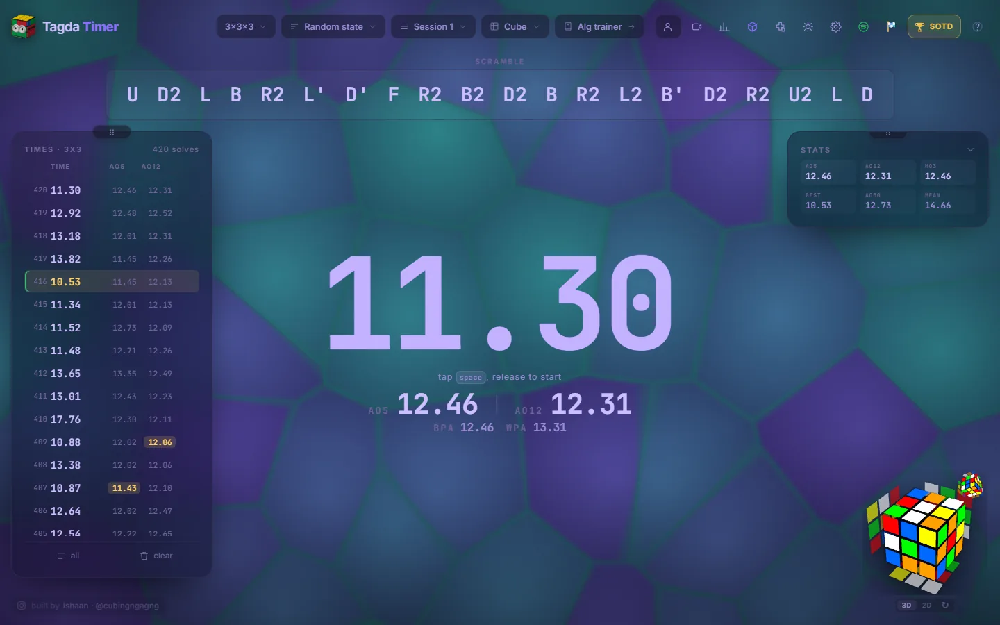

---

## Contents

- [Run it](#run-it)
- [Timing](#timing) — scrambles, inspection, input methods
- [Events](#events) — Fewest Moves, Relay, Blindfolded
- [Training](#training) — trainers, learn mode, alg trainer, Cross + 1, reconstruction
- [Competition Mode](#competition-mode) — Ao5, Ao12 or your own set size, with one continuous replay
- [Statistics](#statistics) — averages, charts, the times list, webcam replay, share cards
- [Playing with other people](#playing-with-other-people) — race rooms, random 1v1, Scramble of the Day
- [Making it yours](#making-it-yours) — themes, backgrounds, panels, language, Spotify
- [Your data](#your-data) — storage, sessions, sync, import/export, offline, gear
- [Keyboard shortcuts](#keyboard-shortcuts)
- [Layout](#layout) · [Deploying](#deploying) · [Admin console](#admin-console) · [Not in this version](#not-in-this-version) · [License](#license)

---

## Run it

Double-click **`start.bat`**. Your browser opens on its own.

From a terminal instead:

```bash
python serve.py
```

> **Do not open `index.html` by double-clicking it.** Browsers refuse to load
> JavaScript modules from `file://` addresses, so you get a dead page with a
> frozen timer. It has to be served over http. If you do it anyway, the page
> tells you so rather than sitting there silently.

`serve.py` is a normal static server with caching turned off, so edits show up on
refresh instead of you fighting a stale cache.

There is **no build step**: no Node, no npm, no bundler. It is plain ES modules,
so any static file server works, and deploying means uploading the folder as-is.

To check everything still works after a change, open <http://localhost:5173/test.html>.
It tests the statistics maths, the learn-mode scheduler, every trainer algorithm (by
simulating a real cube), the reconstruction model and solver (superflip, the wide-turn
identities, and whole CFOP solves driven only by the suggestions it gives back), and
the rendered page itself (that no overlay is stuck on screen).

There are also focused checks that run under Node: `npm ci`, then
`npm run test:settings-search`, `test:stats-session`, `test:stats-units`,
`test:stats-cache` or `test:site` (a browser audit of the layout, timer, tools and
settings; it needs Playwright and the dev server running). `tools/` holds the
database-rules checks, which run against the Firebase emulators. These dependencies
are only for tests; serving the timer still needs no build step.

---

## Timing

### Scrambles
- **Every WCA event**: 2x2 through 7x7, 3BLD/4BLD/5BLD, FMC, OH, MBLD, Clock,
  Megaminx, Pyraminx, Skewb and Square-1. FTO and [Relay](#relay) are in the menu as well.
- Generated with **cubing.js**, which wraps the same random-state solvers TNoodle
  (the WCA's own scrambler) uses. These are competition-grade scrambles, not random moves.
- A **queue keeps three scrambles ready** at all times. A random-state 4x4 scramble
  takes about 3.5 seconds to compute, but you never wait for one, because the next is
  ready before you finish the current solve. Every other event is warmed in the
  background too, and unseen scrambles are kept in the browser, so switching event
  (even straight after a reload) hands one out at once.
- **Square-1 and Clock scrambles are made here**, not by cubing.js: cubing.js takes
  15-27 seconds for a Square-1 scramble in Firefox. The Square-1 one is a two-phase
  random-state scrambler running in its own worker (a few milliseconds), and Clock's is
  a random dial amount per move in the WCA order.
- cubing.js is **vendored into `vendor/`**, so scrambles work with no internet at all.
  Re-mirror it any time with `python tools/mirror_cubing.py`.
- **A static 3D preview** of the scrambled cube, which you can drag anywhere and
  spin. `V` switches to a flat 2D net, and Appearance → *Cube colours* recolours the stickers.
- **Fewest Moves scrambles are real FMC scrambles.** cubing.js already wraps the `333fm`
  scramble in `R' U' F` at both ends. That hides where the scramble really starts, so
  you cannot work a solution backwards out of it (WCA E2e).
- **Your own scrambles.** Paste a list (a competition round, a set of cases, ten
  thousand lines) and the generator steps aside. Every *next* gives you the following
  line, in order, and each solve is saved with the scramble it was done on. The
  list survives a reload, and the timer goes back to generating its own once the list
  runs out. Button beside the scramble, or `X`.
- `R` repeats the last solve's scramble; `←` / `→` step back and forward.

### Inspection
Exactly as in competition: 15 seconds, callouts at 8 and 12 (a beep, a voice saying
"8 seconds" and "12 seconds", or nothing: Settings → Inspection), automatic
**+2 past 15 seconds** and automatic **DNF past 17**. The countdown is not a small number
in a corner. A ring of light drains around the screen edge, the background warms from
neutral to amber to red, and the digits breathe faster as time runs out.

Inspection is turned off automatically for the blindfolded events and FMC.

### Timing input
Four sources, one at a time, chosen in Settings → Timing input:

- **Keyboard / touch**: the spacebar, or a tap anywhere on a phone.
- **Typed times**: type under the clock and press Enter. It reads `12.34`, `1:05.67`,
  bare digits (`1234` is 12.34), `12.34+2` for a plus two, and `DNF`. Each entry is saved
  against the scramble on screen and moves on to the next.
- **Stackmat on the aux jack**: run a 3.5 mm cable from the timer's data port into the
  microphone socket. The 1200-baud stream is decoded in an AudioWorklet, either polarity,
  any Stackmat revision (it matches the packet checksum, not the frame length).
  A bar under the clock says whether packets are actually arriving, so a wrong socket or
  a muted input shows up in a second rather than a whole session later. With more than one
  microphone input, pick the one the cable is in (Settings, or the Stackmat pill in a race or
  the Scramble of the Day).
- **Virtual cube**: csTimer's keyboard cube. Every key on the letter block is one turn
  (`I`/`K` are R/R', `J`/`F` are U/U', and so on, mapped by physical key so it works on
  any layout). The first real turn starts the clock and a solved cube stops it. The cube
  sits in the middle of the screen with the clock on the right.

Bluetooth smart timers are deliberately **not** supported. Every model speaks its own
encrypted protocol, and code that has never been tested on one would be a button that fails silently.
The aux route works with any Stackmat, which is what those timers imitate anyway.

### Around the clock

- **While running** the clock can show everything, whole seconds, or nothing at all
  (*Full / Seconds / Hidden*). The final time is always shown in full.
- **Confirm misfires** asks before keeping a solve that is too short to be real, with a
  threshold you set (0.3-5 s, 0.5 by default). **Show start hint** turns the "tap space,
  release to start" line off without moving the digits.
- **BPA / WPA**: once four solves are in, the best and worst possible ao5 appear under your
  averages and in the statistics drawer, trimmed exactly like every other average.
- **Scrambles only** turns the timer off for when you just want scrambles: Space, a tap or
  a swipe deals the next one.
- **On a touch screen**, swipe the scramble left for the next one and right for the one
  before. The last solve has buttons for +2, DNF, Note and Reconstruct, and a way to cancel
  inspection.
- **Session goals**: give a session a target (a time, or a move count in FMC) for a single,
  ao5 or ao12. A quiet line under the scramble shows how close you are and the share of
  solves under it, and beating it for the first time plays the PB celebration once.

### Accuracy
All timing comes from `performance.now()` timestamps, never from counting frames, so no
amount of animation or lag can change a recorded time. The inspection penalty is read
from a fresh clock reading at the instant the timer starts, not from the last animation
frame.

A **metronome** (Settings → Timer) can tick while you solve, and a floating metronome
window with its own start/stop and a beat meter can sit over the timer or the alg trainer
while you drill a case to a beat.

---

## Events

### Fewest Moves

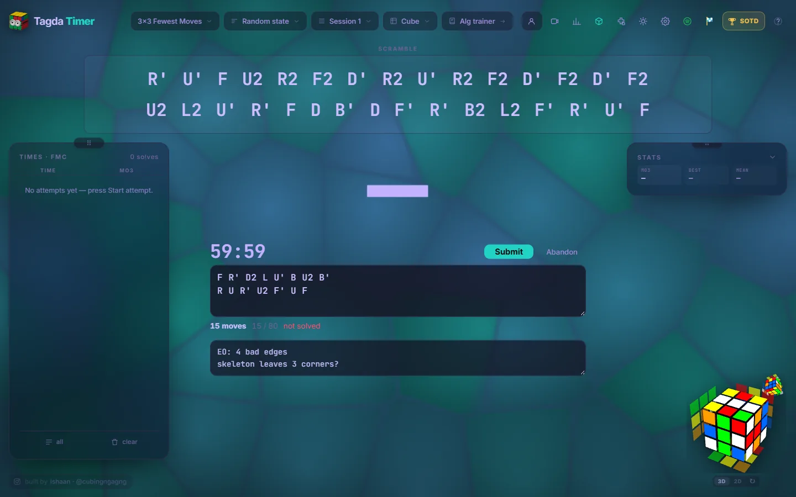

Picking 333fm replaces the hold-to-start timer with an attempt. **Start attempt** freezes
the scramble and starts a 60-minute countdown (WCA E2b). The countdown is worked out from
a timestamp, not counted in frames, and is kept in IndexedDB, so if the page reloads or
crashes forty minutes in, the attempt comes back with the right time left. There are calls
at five minutes and one minute, using the same tone as inspection.

You get a solution box and a scratch-notes box. Under the solution, live: the move count
in OBTM, the ETM count against the 80-move limit (amber near it, red over it; the limit
is on ETM but the score is OBTM, and the two numbers differ), the first illegal move
named and explained, and whether the cube is actually solved. The
cube preview shows the scramble with whatever you have typed applied, so an unfinished
solution shows how far you have got. Any final orientation counts.

**Submit** early is allowed; **Abandon** asks first and records a DNF; running out of time
submits a solution that works and records a DNF for one that does not. The move count, the
solution and the notes are all stored on the solve, so the history shows what you wrote,
including on a DNF, which is exactly the one you want to look back at. *Reconstruct this solve*
opens the workbench on the solution you already wrote down.

Notation is WCA 12a, strictly: outer faces, `Rw`-style outer blocks and `x y z` rotations.
`M`, `E` and `S` are refused. A move typed in the wrong case is read as the right one, and
a bare `r` counts as `R`, not `Rw`. That is what E2c6+ says, and the opposite of what
most cubing software does, so the app tells you rather than silently scoring
something you did not mean.

FMC is **scored in moves, not seconds**. The times list reads `28` rather than `0.03`,
the charts are labelled in moves, and the panel shows the mean of 3 and best single a
competitor actually sits (WCA 9b4a). The rolling ao5/ao12 are hidden, because nobody keeps
a rolling average of twelve one-hour attempts. One DNF makes a mean of 3 a DNF (9f11).

### Relay

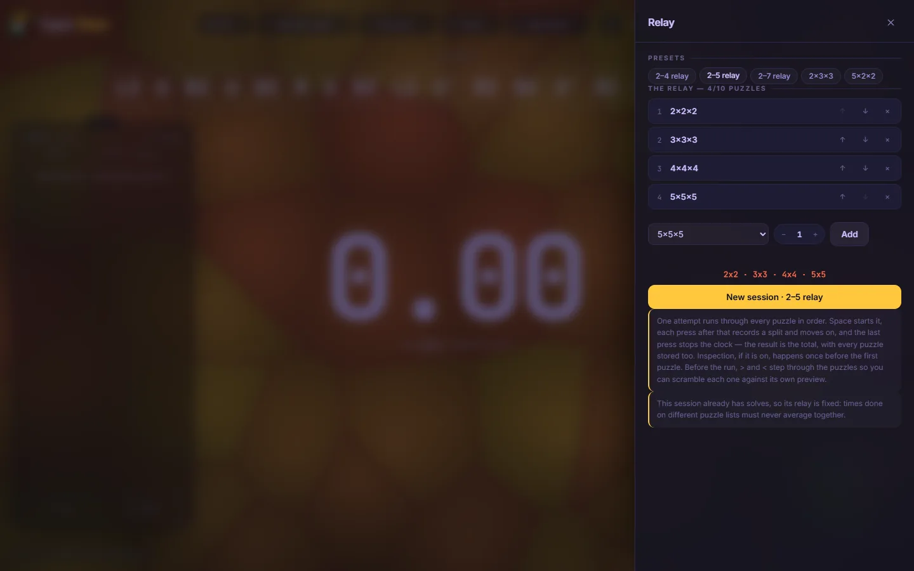

Pick **Relay** in the event menu to time several puzzles as one attempt: a 2–5 relay,
two 3x3s, five 2x2s, anything up to ten puzzles. The relay builder has presets (2–4,
2–5, 2–7, 2×3x3, 5×2x2), an event picker with a 1–5 count, and up/down buttons to
reorder. Only ordinary single-scramble events can go in (no blindfolded, FMC or
multi-blind), and scrambles are always random-state.

- **One attempt, one timer run.** Start normally, then press Space once after solving
  every puzzle to save the total. In the relay builder, **Press Space after every
  puzzle** defaults off; turn it on to record per-puzzle splits instead. Every puzzle's
  scramble is stored in either mode. +2 and DNF apply to the whole attempt.
- **One puzzle on screen at a time.** A row of chips replaces the single scramble line,
  each showing upcoming, active, or done with its split. The scramble box and the 3D preview
  show only the active puzzle. Before the run, **<** / **>** or a click on a chip steps
  through them so you can scramble each one against its own preview. **all** swaps the box
  for a plain numbered list of every scramble, for printing or copying.
- **During the run** the chip row stays visible even in focus mode, and each puzzle's
  time stacks up beside the clock with "on 4x4 · 3 of 5" underneath.
- **Inspection**, if on, happens once before the first puzzle.
- **Each relay gets its own session.** Building one makes a session named after it;
  switching sessions switches relays, so two different puzzle lists never share an
  average. You can only edit a session's relay while it has no solves.
- The main stats and charts use the total. **Statistics** adds a per-puzzle card: mean and
  best split for each position and its share of the total. A solve's menu lists every
  split with its scramble, **Reconstruct** is offered for the 3x3 legs, the share card
  lists the scrambles as a table, and CSV export gains a `splits` column.
- Relays are not available in race rooms, Scramble of the Day, or with your own pasted
  scrambles.

### Blindfolded

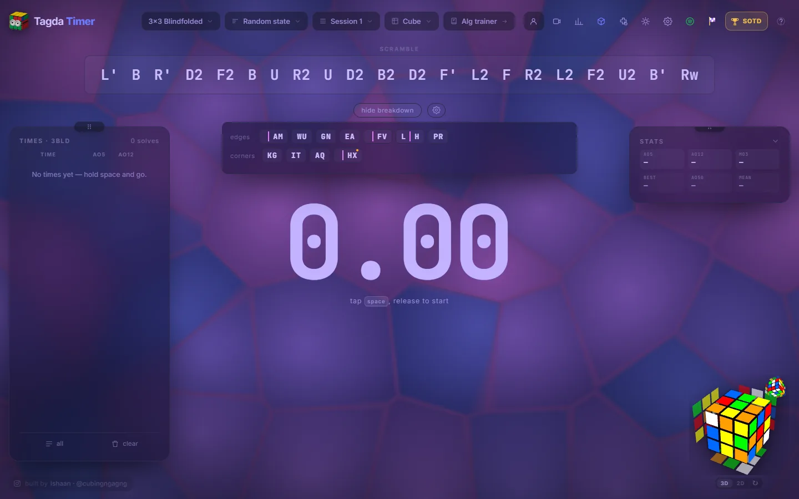

On 3BLD a **Show breakdown** button appears under the scramble. It stays collapsed until
you ask for it, and then reads the scramble out as your memo: edge and corner letter pairs
for your own buffer and letter scheme, cycle breaks marked, flipped and twisted pieces
flagged, and a parity badge when there is one. Buffers, the orientation the letters were
assigned in, and all 48 letters are editable in Settings → Blindsolving. Speffz and white
top / green front are only the defaults.

Click any pair to see the word, image, commutator and notes you saved for it, without
leaving the timer. On a blind event, the first press mid-solve ends the memo, not the
solve. Every solve therefore records a memo time and an execution time, and the statistics
drawer tracks how that split is drifting against your own average. After a DNF you can click
the pieces that were still wrong on a flat net and match them against the memo saved
with that solve.

The bigger blind events are timed and split like 3BLD but not traced. Only the 3x3 is
modelled, and guessing at wing and centre cycles would be worse than saying so.

---

## Training

### Trainers

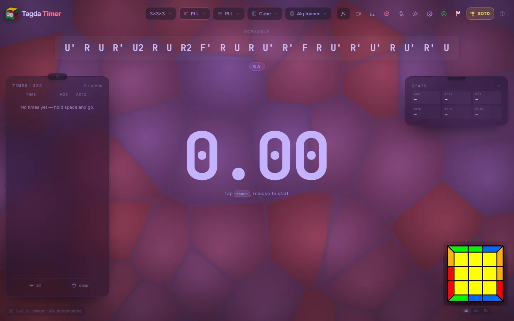

Every trainer knows which case it dealt you, which is what makes **per-case statistics**
possible: the app can tell you your G-perm is 1.4 s slower than everything else.
Picking a trainer opens a session of its own, so drilling PLLs never lands in your
full-solve averages.

| Mode | What you get |
|---|---|
| F2L | all 41 first-two-layers cases, grouped the way they are taught |
| PLL · OLL · ZBLL | all 21 · all 57 · all 472 (by family: T, U, L, H, Pi, Sune, Antisune) |
| 2-look OLL · 2-look PLL · OCLL | the beginner subsets |
| Winter Variation · Summer Variation · VHLS · ZBLS | last slot: the pair in while orienting the last layer (WV, SV) or its edges (VHLS, all 302 ZBLS) |
| COLL · OLLCP | the advanced last-layer sets |
| 2-look CMLL · CMLL · OH CMLL · LSE EO · EOLR | Roux |
| Last layer | a random OLL and PLL stacked together |
| Cross solved | cross already done: drill F2L + LL |
| Last slot + LL | three pairs in, one to go |
| 2-gen (R,U) · Roux LSE (M,U) · Roux L10P | restricted move sets |
| Cross practice | full WCA scramble, time your cross only |
| Other puzzles | 2x2 OLL · PBL · CLL · EG-1 · EG-2, 4x4 PLL parity and *Centres solved* (a practice scramble, not random-state), Pyraminx last layer and L4E, Skewb Sarah's Intermediate and Advanced, Square-1 shape · CSP · OBL · EO · CP · EP |

Press **K** to pick exactly which cases you want, including a "my worst 8" button that
selects the cases you are slowest at. Where a set has groups (F2L's six pair states,
ZBLL's seven families, OLL's shapes), a row of chips narrows the grid to one of them, and
`all` / `none` / `invert` then work on just what is showing. Picking only the Sune set out
of ZBLL's 472 is two clicks.

Trainer cases are previewed **yellow on top, white cross underneath**, the way the
algorithm sites draw them and the way you are already holding the cube. Official WCA
scrambles keep the white-on-top, green-front orientation they are defined in, because
there the preview's job is to match the cube you just scrambled. Turn it off under
Appearance → *Yellow on top*.

Every algorithm in the tables is verified by cube simulation in `test.html`: all 21 PLLs,
57 OLLs, 41 F2L cases and 472 ZBLLs produce the correct, distinct case.

### Learn mode
The trainers deal a case and time it. **Learn mode** (*learn these cases* in the case
picker) is the part that teaches you a case, and it works on top of whichever trainer you are already
in. PLL is still PLL; learn mode only changes *which* PLL you get next.

- **A case you have never seen arrives with its algorithm on screen.** There is
  nothing to recall yet, so nothing is hidden.
- **After that it is recall.** The alg is hidden; `G` brings it back, and asking for it
  counts as not knowing it. That is the whole signal, so it is never taken quietly.
- **It grades the solve you actually did.** A clean solve at or under your own average on
  that case moves it forward. A slow solve, or a +2, keeps it where it is. A DNF or a peek
  sends it back to the start and brings it back within a few solves,
  not tomorrow. "Slow" is a multiple of *your* average on *that* case, because 1.5x is
  a different number for a sub-10 solver and someone learning their first PLL.
- **A case is never marked known without the evidence.** Until a case has enough
  solves to have an average, everything passes. So a case stops one step
  short of *known* and waits for one, rather than graduating on three lucky attempts.
- **New cases arrive a few at a time** (five per sitting by default), so switching learn
  on in ZBLL teaches you five cases rather than dumping 472 unknowns on you.
- It works on exactly the cases switched on in the case picker, so *my worst 8* plus
  learn mode is a session about the eight cases you are worst at.
- The strip under the scramble shows where the set stands: how many cases are new,
  being learned, known, and due right now. When nothing is due it says so and goes back
  to dealing the set at random.
- Schedules are saved in your browser with everything else and included in the JSON
  backup. Restoring an old backup merges with your progress rather than resetting what
  you have learned since.

### Alg trainer

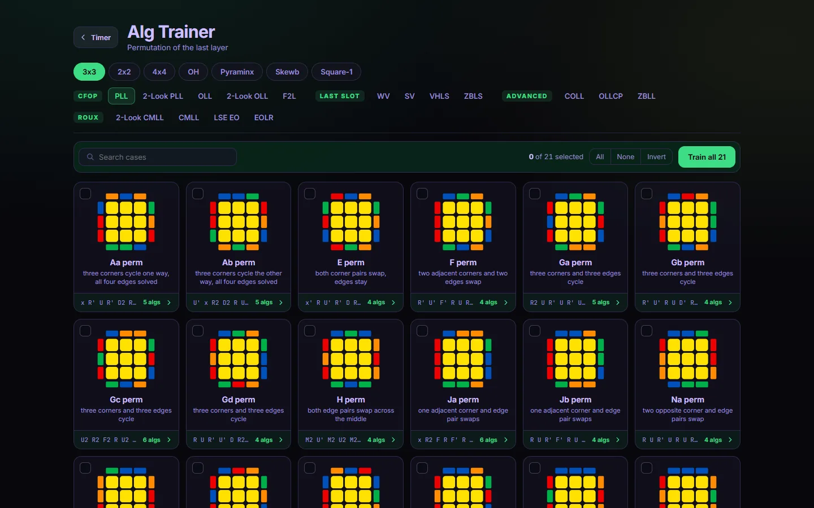

A full algorithm library on its own page (`algs.html`, the **Alg trainer** button in the
top bar), covering **3x3, 2x2, 4x4, OH, Pyraminx, Skewb and Square-1**. The 3x3 sets are
grouped by method: CFOP (PLL, 2-look PLL, OLL, 2-look OLL, F2L), Last slot (WV, SV,
VHLS, ZBLS — see [LASTSLOT.md](LASTSLOT.md)), Advanced (COLL, OLLCP, ZBLL) and Roux
(2-look CMLL, CMLL, LSE EO, EOLR).

- **Every case is a picture first.** The name and group are metadata underneath, so
  you find a case by recognising it, not by remembering its letter.
- **Several ranked alternates per case**, each with its move count. Drag them into your
  own order, or add an alg the library does not list. Your order is personal and saved
  locally.
- **Setup moves for every case**, so practising means "do the setup, then solve it", not
  reading the alg backwards in your head. A setup that is just your own alg reversed is
  only used when nothing shorter exists.
- **Every alg is executed against its case** by `tools/verify-alglibrary.html` before it is
  committed. The scraped data did not all pass that check, and what failed was fixed or dropped.
- **Select cases and press *Train*** to drop them straight into the timer as a drill, in a
  session of their own.

### Cross + 1

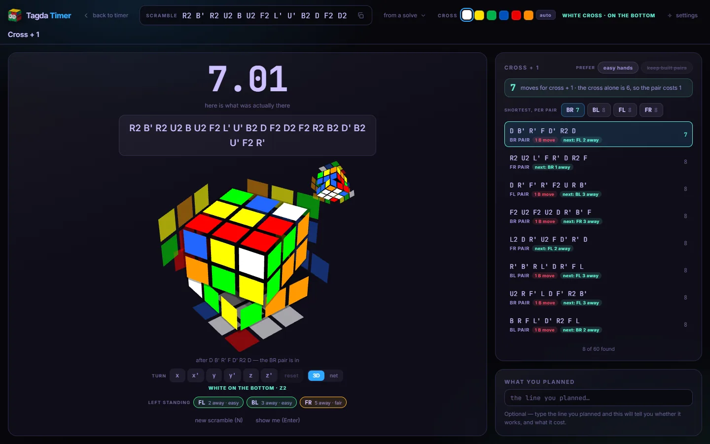

A trainer for planning the cross **and** the first F2L pair in inspection, not just the
cross. Open it with the cross-and-block icon in the top bar or `L`.

- You get a scramble and unlimited inspection. Plan your cross and first pair, then start
  the timer: the scramble and the cube preview **black out** and you solve on your real cube.
- When you stop, it shows what the solver found: every short cross + 1 line, which
  pair each one inserts, and how far away the remaining pairs are left. Sort by
  **shortest** or **easy on the hands**, and ask it to **keep built pairs**.
- Type the line you planned and it tells you whether it works and what it cost.
- Pick the cross colour (or `auto`), turn the cube, and drill your own scrambles or a past
  solve's.

### Reconstruction

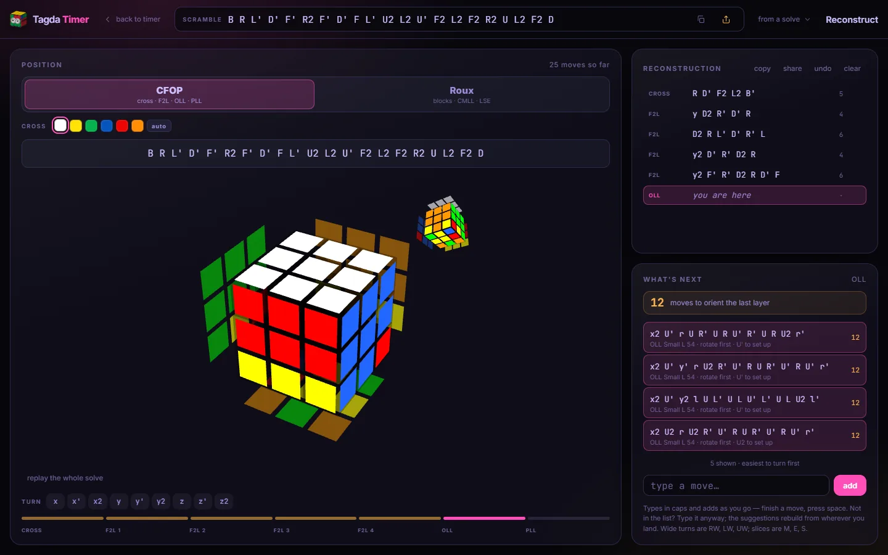

A workbench for working out what you actually did, and what you could have done
instead. It is a separate screen from the timer: it opens from a solve's menu
(*Reconstruct this solve*), the **reconstruct** button beside any row of the times list,
the topbar cube button, or `Y`.

- **CFOP or Roux.** A switch at the top picks the method. Roux gets its own phase detection,
  progress strip and suggestions: first block, second block (the easier square first), CMLL
  from the app's own alg set, then EO, UL/UR and the finish, counted in slice turns. Pick
  the bottom and front colour to pin which side the first block is built on, or leave it on
  `auto`. Switching method re-cuts the lines you typed; nothing is lost. Details in
  [RECONSTRUCTION_ROUX.md](RECONSTRUCTION_ROUX.md).
- **It suggests the moves.** From wherever the cube currently stands, it works out
  every shortest way forward, ranked by move count and then by how comfortable they are to turn.
  The search runs in a worker, so a hard last-slot position can take a second or two of
  thinking without freezing the page (or the cube mid-turn).
  Cross and F2L are solved by search against a pruning table, so "6 moves" means six
  and not "six that I happened to find". The last layer is not searched, it is
  simulated against the full alg libraries, so you get the alg you recognise.
  **Pick the slot** (`FR` / `FL` / `BL` / `BR`) to see pairs for just that one.
- **Every spelling of the case, not just one.** The last-layer libraries carry
  every alg the community actually uses (228 for the 57 OLLs, 83 for the 21 PLLs),
  so the alg *your* fingers know is on the list. Every one is checked
  against the cube model in `test.html`.
- **ZBLL, when the edges are already oriented.** If F2L leaves the last layer's edges
  oriented, the whole layer can be solved with one alg instead of two. The panel
  spots that, checks all 472 ZBLL cases (1790 algs), and lists what it finds above the
  OLLs, tagged `ZBLL`.
- **Nothing is ever refused.** Type a move that is not in the list and it simply
  becomes the new position, with a fresh set of suggestions from there. The move counter
  goes up, and turns amber, when the move you made cost you something.
- **The cube keeps up.** Hover a suggestion and it plays on the cube; click it and the
  position advances. *Replay the whole solve* turns the panel into a playback you can
  scrub through, starting from the scramble.
- **The move box types in caps and adds as you go.** Finish a move, press space, and
  it lands. Wide turns are `RW`, `LW`, `UW`, stored and drawn as `Rw`, `Lw`, `Uw`.
- **Pick your cross colour** from six swatches, or `auto` to work it out from the cube
  (which reads a solve that starts `x2` or `z'` correctly).
- Reconstructions are **saved onto the solve**, split into cross, four pairs, OLL and PLL.
- **Copy it or make a card**: the whole thing as text, or a share card with the scramble,
  the cube it makes, and the solution one line per phase.

Any scramble works, not just a recorded solve. Paste one into the field at the top, or
pick a past solve from *from a solve*. ZZ and freestyle solves will not split into
phases cleanly, and the workbench says so rather than guessing. On a phone the workbench
has its own layout, typed on a move pad.

---

## Competition Mode

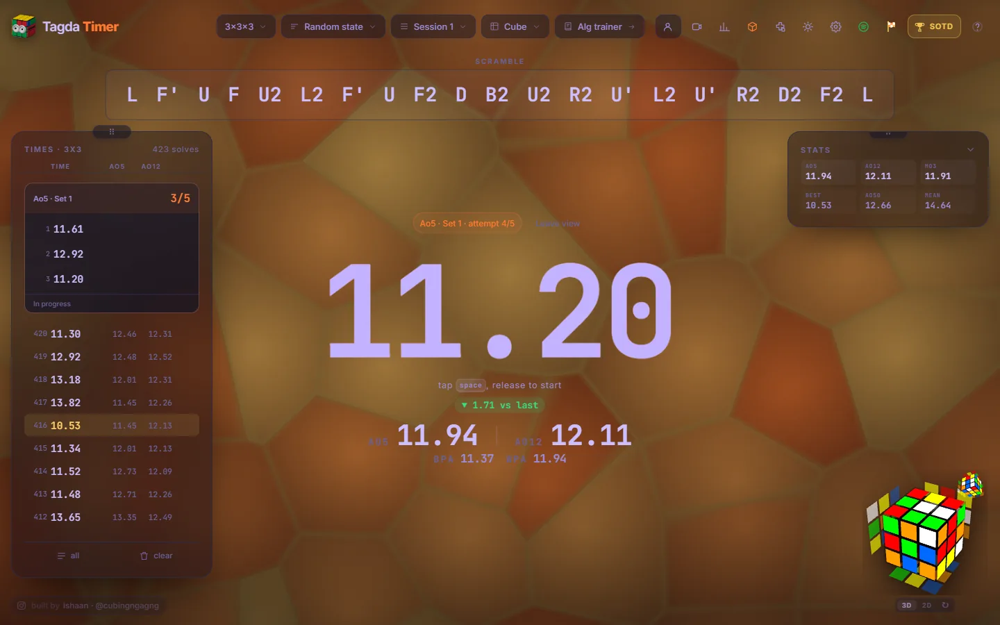

Start it from the **Session** picker (on a phone, the Sessions section of the event sheet).
Choose **Ao5**, **Ao12**, or a custom whole number of attempts of at least 5. The event and
set size are fixed, and the set stays in the current session. Switch explicitly to Random
state when leaving a trainer or a pasted scramble list. Relay, FMC, Multi-Blind, race and
virtual sessions are excluded.

- **Durable.** Every attempt is saved in order, and the set resumes after a refresh. **Leave
  view** lets you do ordinary practice, and **Return to set** picks the set back up. When the
  set is complete it opens the exact average and stops collecting attempts; **Start another
  AoX** begins the next one explicitly. Competition history has session and event filters, and
  ordinary rolling averages are untouched.
- **Nothing is quietly editable.** Individual attempts cannot be deleted. You can correct their
  penalties, discard an unfinished set, or delete a whole average and its replays. Whole-set
  deletions have no undo, and merging an old backup cannot resurrect a deleted set. Tagda
  backups include `competitionSets` (format version 2); old ordinary backups still import.
- **One replay for the whole set.** By default replay follows the ordinary per-solve
  setting. **Record entire AoX** is opt-in at setup: it records scrambling, inspection,
  attempts and the gaps between them into one local video, up to **30 minutes / 256 MiB**
  with a 32 MiB storage reserve (the limits do not limit the number of timed attempts).
  Chunks are saved every two seconds, so a killed page loses at most the last one. Leaving
  the view, switching sessions or tabs, a camera failure, device sleep or running out of
  storage interrupts the recording while keeping your solves, and the surviving footage is
  labelled *interrupted*. A wake lock keeps the screen on while it records, and the recording
  stops when the tab is hidden.
- **Save video** offers **Original**, **Landscape** and **Reel**, the same crop controls and
  MP4/WebM pipeline as an ordinary solve. Landscape and Reel show attempt numbers, clocks and
  current penalties. These videos live in their own local database and are never pruned to
  make room for another capture. Cloud sync and JSON backups carry the set's metadata and
  solves, not the video: on another device it says the video is stored on the original one.
  The updated `firebase.rules.json` must be published for the new fields to sync.
- **A score-sheet card** for completed sets: a paper-style card, branded Tagda Timer and
  labelled as unofficial practice, with numbered results, trim markers and the calculated
  final average. It uses the same copy, save and device-share controls as any share card,
  paginates at 12 rows per image, and uses the corrected score if you fixed a penalty
  (cards you already exported stay as they were).

See [Competition Mode verification and handover](docs/competition-mode.md) for the checks and
local preview instructions.

---

## Statistics

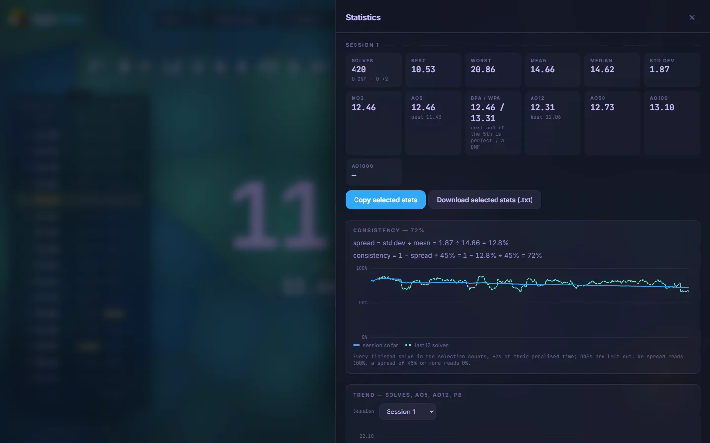

WCA-correct averages: trim the best and worst, DNFs count as worst, and two DNFs inside
a window make the whole average a DNF. Current and best ao5 / ao12 / ao50 / ao100 / ao1000,
mo3, mean, median, standard deviation, and a consistency score.

Five charts, all hand-drawn SVG: a trend line with rolling ao5/ao12, your PB and DNFs
marked; a distribution histogram; a practice heatmap with streaks; a consistency dial; and a
per-case ranking for trainer sessions. The trend line can be filtered to [one cube](#gear).

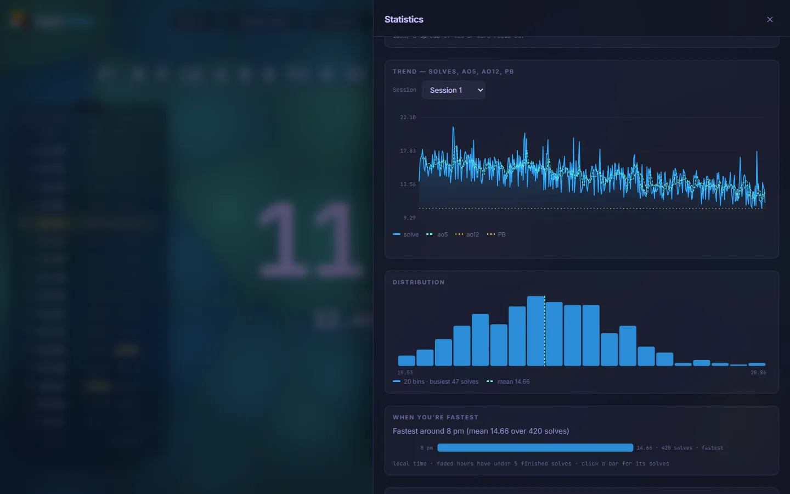

- **Pick the sessions it counts.** Statistics can cover one session, several or all of them,
  and *Copy selected stats* / *Download selected stats (.txt)* export exactly what is selected.
  The consistency tile opens the drawer and shows how its percentage is worked out.
- **Pin and brush the trend.** Click a point to pin that solve (time, penalty, date and
  scramble, with *Repeat this scramble*, *Reconstruct* and *Copy scramble*); the arrow keys
  step to the neighbours. Drag across the chart to select a range, see its count, mean and
  best, and load those scrambles into the custom queue.
- **When you're fastest** groups the session by hour of the day, and **Do you slow down?**
  compares the early and late stretches of a sitting (split at 30-minute breaks). Click a
  bar for its solves. DNFs are left out of every mean and counted beside it.

**New PBs are celebrated**: a chime, confetti, a shockwave and a PB ticker when you beat
your best single, ao5, ao12, ao25 or ao100. The chime can be turned off in Settings.

### The times list
The sidebar list scrolls all the way back to the first solve of the session, loading a
page at a time as you reach the bottom. Only what is on screen is built, and a re-render
changes only the rows that changed rather than rebuilding the list. On a 5,000-solve
session, loading another page takes about a millisecond, and toggling a penalty with every
row expanded about 30 ms, compared with two full seconds for a full rebuild.

Beside every time are two rolling averages: ao5 and ao12 by default, or whichever two
you actually chase. The pencil on a column heading lets you change it to an ao3, an ao25
or an ao100. Clicking a heading sorts the whole session by that column, fastest first;
clicking again puts the list back in solve order. Any average in the list opens the solves
behind it. Hover a row for its **reconstruct** button, or open its menu to set a penalty,
comment, share, or delete.

### Webcam replay
The **camera button** in the top bar (it stays in the bar on a phone too) turns on
**webcam replay**: every attempt is filmed, from the press (or the start of inspection) to a
second after the stop. The button lights up while it is on and shows a **red dot while an
attempt is being filmed**. After a filmed solve a **▶ Replay** pill sits under the time, the
times list puts a ▶ after that solve, its menu has **Watch replay**, and **W** plays the last
one. The clock runs **in a bar under the picture, never over it**: the inspection countdown,
then the time, then the final result with its penalty. Step a frame at a time with
**← →**, slow it to 0.25×, or jump to the start (**Home**) or the stop (**End**). On a phone on
its side the clock moves beside the picture instead.

**Record sound** (off by default, because it hears voices too) adds the sound to each clip.
Pick the mic under the camera; left on Automatic it uses the camera's own mic, else the system
default. With a **Stackmat** as the input it never records from the mic input the Stackmat is
plugged into: it takes another mic if there is one, and otherwise films without sound. The line
under the preview always says what the clips will hear. The player starts muted; press the
speaker button (or **M**) to unmute, and that choice is remembered. Saved videos carry the
sound too (AAC where the browser can make it, otherwise Opus).

**Save video** makes a real MP4, three ways:
- **Reel** (1080×1920): the share card with the solve playing in it. First drag a square over
  the picture (and size it) to choose what it shows; that square is remembered per camera.
  Under it, the clock beside a picture of the scrambled cube, the scramble, and tagdatimer.me
  and @cubingngagng.
- **Landscape** (1920×1080, 16:9): the whole picture as filmed, with the clock, the cube, the
  scramble and the links in a panel beside it.
- **Original**: just the video as filmed, with a small tagdatimer.me in the corner.

On a phone it offers **Share**, straight into Instagram or a chat. The videos are made in the
browser with [Mediabunny](https://mediabunny.dev) (vendor/mediabunny, MPL-2.0) over the
browser's own video encoder, a few seconds for a solve. If that encoder will not start, the
video is recorded live instead, which takes as long as the clip (and is a WebM in Firefox).

Pick **any camera** the device can see: a phone's front or back camera, or a phone connected
to a laptop as a webcam (Phone Link, Continuity Camera, DroidCam). The camera panel shows a
live preview to aim it with. If the chosen camera is unplugged, the next attempt is filmed on
another one and says so, and plugging it back switches back.

Quality is **Standard** (640×480), **HD** (1280×720) or **Full HD** (1920×1080). Full HD is
offered when the camera can film it (or the browser cannot tell), and a phone held upright
(1080×1920) counts. HD takes about three times the space of Standard and Full HD about four
and a half (a 30-second solve is roughly 20 MB at Full HD), and the newest 50, 200 or 1000 are
kept either way. The saved videos are the same sizes whatever you film at, but from a Full HD
clip the picture in them is sharp instead of stretched. If Full HD runs below 24 fps on your
camera, or the camera sends less than Full HD, the line under the preview says so.

Clips stay **on this device only**, in their own database, never synced. Keep the newest
**50, 200 or 1000**; a **PB single's clip is kept for good**, and so is any you mark
**Keep forever** in the player. A misfire you discard is never saved.

The one exception is yours to make: **Scramble of the Day replays**. After you submit the day's
attempt, **Share replay** under the board uploads a copy of its clip (720p at most, sound only
if you tick *Include sound*), and everyone else who has done that day's scramble can watch it
from the ▶ on the board or the **Replays** view, for 7 days. **Always share my SOTD replay**
in the camera panel does it every day without the button; it is off until you turn it on. One
share per event a day, removable (for good, that day). The window has its own camera button,
next to Leave. How it stays free and private is in [DAILY.md §8](DAILY.md#8-shared-replays).

The camera is only on while it is needed: it wakes on the press (or the start of inspection),
switches off a second after the stop, and goes the moment you leave the tab. A preview in
Settings or the camera panel keeps it on while you aim it. Solving without inspection? Turn on
**Camera on between solves**, so the clip catches the very start. The browser is never made to
ask for permission in the middle of a solve.

Firefox records with a keyframe only every six or seven seconds, which made scrubbing back
and forth stutter. So once a clip is saved, while the timer is idle, it is re-encoded with a
keyframe every half second and a seek index (a seek went from a median 423 ms to about 60 ms).
Chrome already writes a keyframe every half second, so its clips are kept exactly as recorded,
with their frame times stored, and nothing is re-encoded. Starting an attempt pauses any
conversion, so filming and converting never cost the timer anything. Clips are written to disk
while they are filmed, rather than held in memory until the stop.

The clock is lined up to within a frame using when the recording started, and, in Chrome, the
camera's own frame timestamps. A camera with a slower picture (a phone over Wi-Fi) can still
run a little behind: open **⋯ → Clock delay**, pause on the frame where your hand stops the
timer, press **Stopped here**, and that camera is corrected from then on.

### Share cards

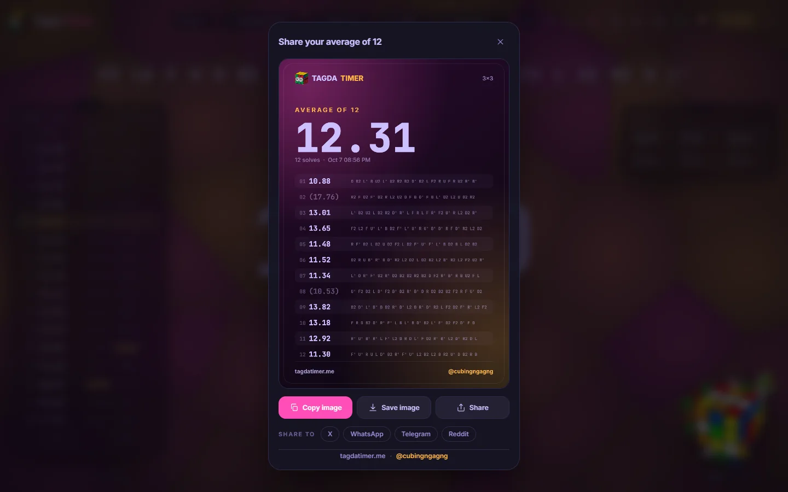

Any solve, and any average, can be exported as an image card rather than a wall of text.

- **One solve**: the time, the scramble, and the cube exactly as that scramble leaves
  it, drawn as a flat net from a sticker-by-sticker simulation, not a screenshot.
- **An average** (ao5, ao12, ao50, ao100, mo3): the counting times with their scrambles,
  trimmed solves in brackets the way results are written up.
- Copy the image, save the PNG, or hand it to the device's own share sheet (the only
  route that reaches Instagram). X, WhatsApp, Telegram and Reddit links are there too.
- The card takes its colours from whatever theme you are on.

Share a solve from its menu in the times list, an average from the `share card` button
on any statistic, or anything from the command palette.

---

## Playing with other people

Race rooms, random 1v1 and the Scramble of the Day need the Firebase project described in
[RACE.md](RACE.md). With no
configuration, race rooms run in **local mode** between tabs of your own browser, which is
enough to develop against and demo.

### Race rooms
Open the flag icon in the top bar, create a room, and share the room code. Nobody needs
an account. Everyone in the room gets **the same scramble** and solves it whenever they are
ready, with their own inspection and their own clock. It is not a synchronised 3-2-1-go,
because network lag would make that unfair in a way nobody could see.

**You cannot see anyone's time until you have finished that scramble yourself.** Until
then you only see that they are *done*. That rule lives in the database, not the UI:
results are unreadable until your own is in, and write-once, so nobody can submit a
throwaway time, peek, and rewrite. Rooms keep standings across rounds, colour each result,
let you edit your own solve, and have a chat. By default each room gets its own session,
so race times do not mix into your practice averages. Details in [RACE.md](RACE.md).

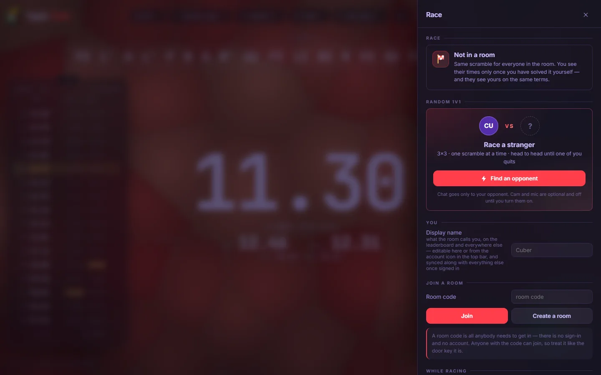

- **Every round is kept.** The times list turns into **Rounds**, **Standings** and **Your
  solves** tabs for a room, and a card under the race panel shows the last round. A round
  waits a moment for the slowest result to arrive, so a time never flashes past.
- **A late penalty counts.** A +2 or DNF you add after stopping reaches the room, a 1v1 and the
  Scramble of the Day. It can get heavier at any time, and lighter only within 15 seconds.
- **Spacebar or a Stackmat.** A race uses the input you chose for racing (typed times are not
  allowed in a race), without touching your usual input mode.

### Random 1v1
**Find an opponent** pairs you with whoever else is looking, on 3x3. There is no code and no
invite: it is an ordinary race room capped at two, which starts by itself and runs one
scramble per round, head to head, with the same hidden-until-you-finish reveal, until one of
you quits. Every 1v1 lands in one session (`1v1 · 3x3`) and gets a head-to-head card and a
*This 1v1* table. The chat only goes to your opponent. There is no skill matching: a rating
the client reports about itself could be faked, so pairing is random.

**Cam and mic are optional**, off until you turn them on, and by default for signed-in players
only (an admin switch). They run peer to peer over WebRTC: nothing passes through Firebase
or the Worker, and nothing is recorded. Your opponent's picture stays covered until you press
**Show**. If a direct connection can't form (a strict network), a short-lived TURN relay is
used. A ⚑ on the opponent files a report for the admins. Details in
[RACE.md](RACE.md#8-random-1v1).

### Scramble of the Day
The **SOTD** button in the top bar. Every day, every signed-in visitor gets the same
scramble per event and **one official attempt at it**, like a competition single. It
resets at **00:00 IST** for everyone, going by the server's clock rather than your
device's, so moving your clock does not get you tomorrow's scramble or a second attempt.

Pressing SOTD enters **the window**: the top bar, sidebars and panels disappear, leaving
today's scramble, the timer, and a slim bar with the day and how long is left of it. Submit
and the leaderboards slide up. Like race rooms, times are hidden until you have submitted
your own, and each result is write-once, apart from an optional one-line note you can edit
(and a penalty that only gets heavier, or lighter within 15 seconds of the solve).
Details in [DAILY.md](DAILY.md).

- **Misfires.** A solve under 2 s on the main scramble is thrown away and you get a hidden
  **backup scramble** as a final attempt; 2-4.99 s asks *misfire? Use backup / Keep*. You can
  never pick the better of the two. (2x2, Pyraminx, Skewb and Clock are exempt, because real
  solves are that fast.)
- **Chat.** Once your time is in, a chat opens beside the board: one room per event per day,
  for everybody who has done that scramble (Google accounts only; a ⚑ reports a message). On a
  phone it is a tab on the board's sheet. Your uploaded profile picture shows on the board
  and in the chat.
- **Shared replays.** After you submit, you can share your clip (720p at most, sound only if
  you tick *Include sound*) so everyone else who has done that scramble can watch it for
  seven days. Sharing is opt-in and removable. See [Webcam replay](#webcam-replay).
- **Stackmat.** A pill beside Camera switches the window between spacebar and Stackmat and
  picks the mic input, without changing your normal input mode.
- **Taking a time down.** Only a site admin can remove a time they think is dishonest; that
  person gets the backup scramble, and a removed backup time is their day.

---

## Making it yours

**Settings presets:** open Settings, enter a preset name, and choose **Save current settings**.
Use **Apply** to restore it (the page reloads), **Update** to replace it with your current
preferences, or **Delete** to remove it. Presets survive refresh, are included in JSON
backups and follow your settings when signed in. Your current event, session, solves,
account details and saved presets are kept when applying. Uploaded background files
remain local to the device that uploaded them.


| Nebula | Vaporwave |
|---|---|
|  | 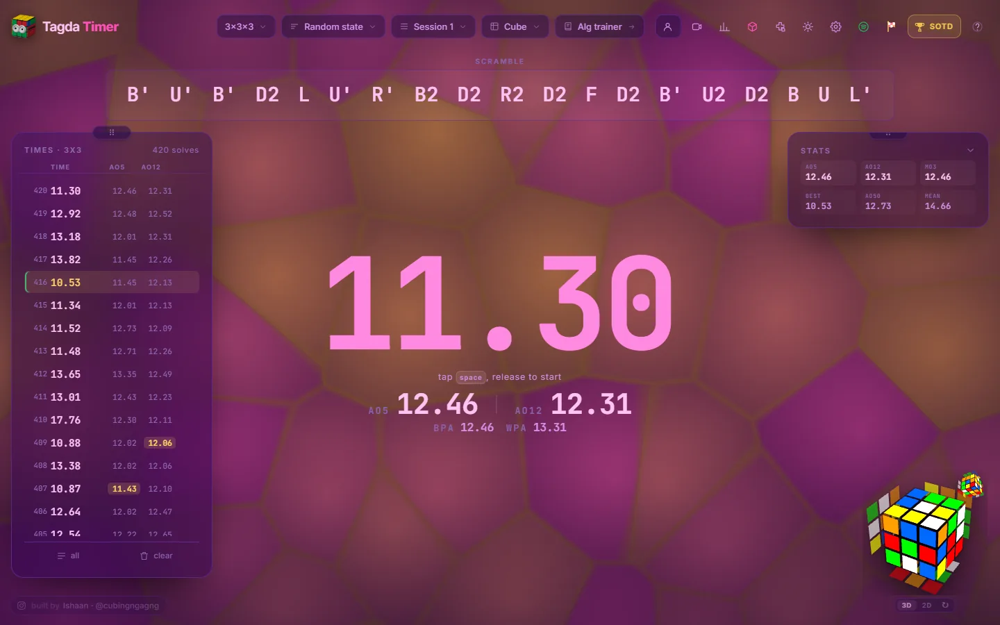 |
| **Terminal** | **Paper** |
| 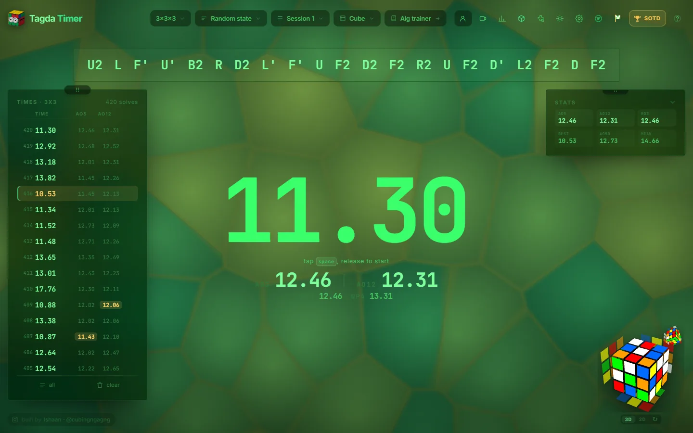 | 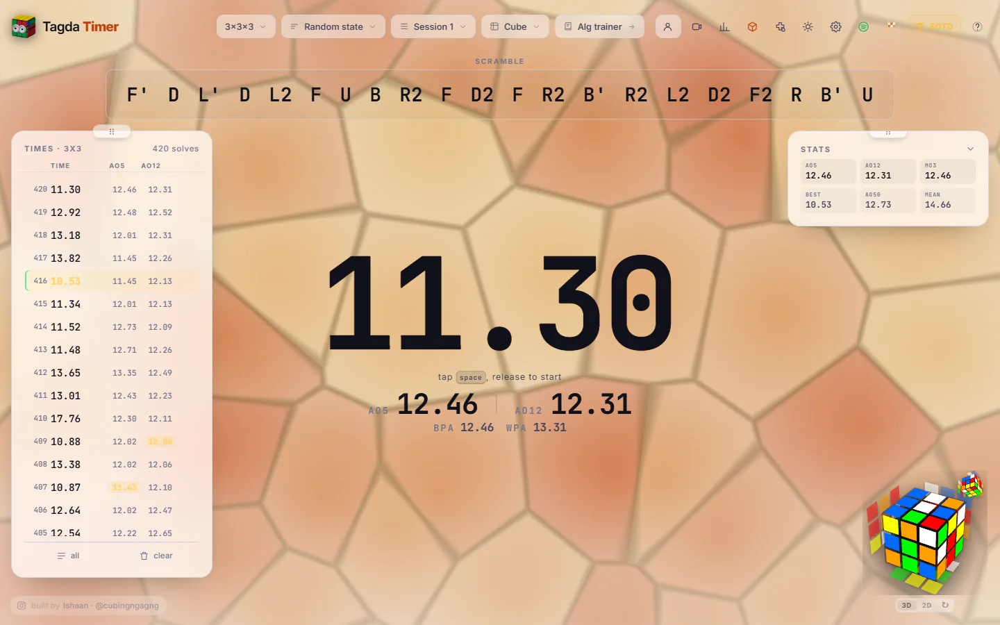 |

The entire design is built on CSS custom properties, so the Appearance panel (`T`)
updates the variables live: drag a slider and the app changes as you drag, no reload.

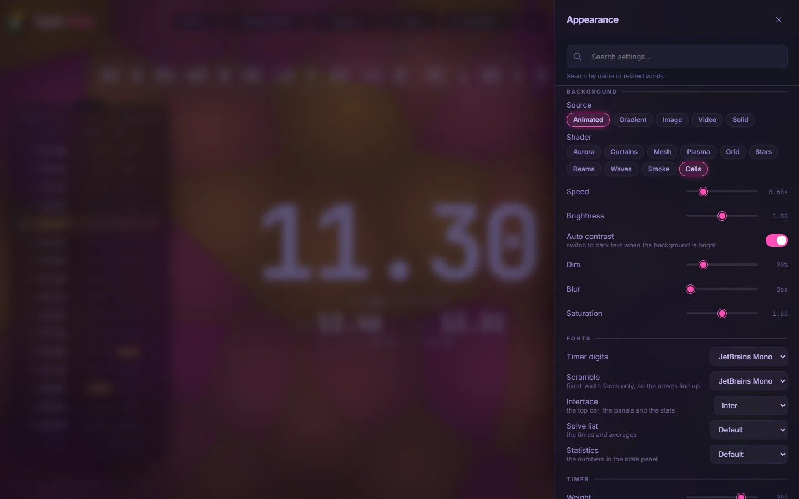

- Seven themes: Nebula, Carbon, Vaporwave, Ice, Terminal, Speedcube, Paper.
- Custom accent colours on top of any theme (every screenshot in this README is the *Cells*
  background in a different palette, made with just the accent, secondary and background
  colours).
- Backgrounds: ten animated WebGL shaders (aurora, curtains, mesh, plasma, grid, stars, beams,
  waves, smoke, cells), a gradient you build from 2-3 colour pickers (angle, linear or radial,
  13 presets, or raw CSS), a solid colour, **your own image**, or **your own looping video**.
  Uploaded media is stored in your browser and never leaves your machine. **Reduce effects**
  keeps the background still and turns glass off, and switches itself on where WebGL is drawn
  by the CPU.
- Background dim, blur, saturation and brightness, so any photo can be made readable, and
  **auto contrast** switches to dark text when the background is bright.
- **Glass** panels: *Off*, *Frosted* or *Liquid* (Liquid bends the background and only
  Chromium browsers draw it; elsewhere it falls back to Frosted).
- **Fonts** for the timer digits, the scramble (monospace only, so the moves line up), the
  interface, the solve list and the statistics, plus weight, size and glow for the timer.
- **A Text block**: one colour for all text, then different colours for the timer digits,
  scramble, solve list and statistics, and a text shadow (strength, blur, distance and colour)
  for reading over a busy background.
- A **profile picture** for your account, cropped and shrunk in the browser and synced with
  your settings. It appears on the Scramble of the Day board and chat.
- Sizes for the scramble, the preview cube, the sidebar, the stats text and the solve list.
- **Cube colours**: six pickers for the preview's stickers.
- **Dockable panels.** Drag the times list, statistics, now-playing card or race panel by
  its grip. The left rail, right rail and bottom bar light up; drop it on one and it
  snaps in, or drop it anywhere else and it floats there.
- Show or hide any panel; widget or flat panel style; compact / comfortable / spacious density.
- Motion: full, reduced, or off (and `prefers-reduced-motion` is respected by default).
- **Language**: English or Spanish (Settings → Language; the whole interface, including the
  solver's suggestions, switches and the page reloads).
- Zen mode (`Z`) hides everything but the scramble and the clock.
- Export your theme as JSON and send it to someone.

### Settings and search

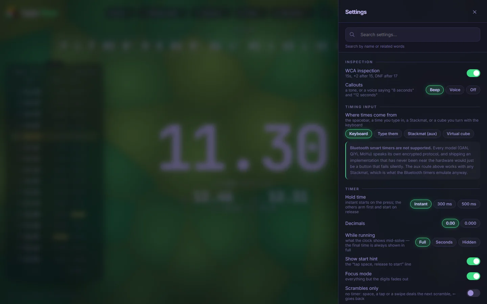

Settings, Appearance and Blindsolving each have a search field that filters the live
controls by name, related words and common typos. For example, `precision` finds Decimals
and `sound` finds the audio options. Clear it to see every option.

### Phones

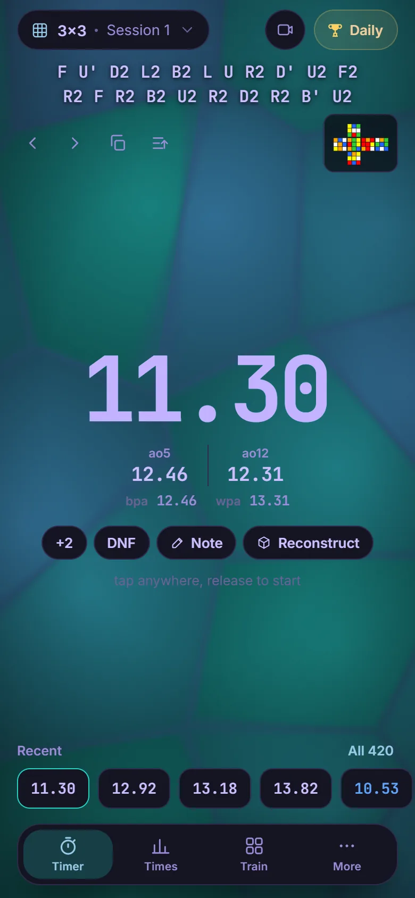

Below 641px wide the app gets a phone layout of its own: a floating dock (**Timer**, **Times**,
**Train**, **More**) replaces the top bar, one pill picks the event and session, and the
scramble, big digits, ao5 / ao12 and the +2 / DNF / Note / Reconstruct buttons sit on the Timer
tab with a strip of recent times. Tap anywhere to start and stop. The dock steps aside for
inspection, the solve, focus mode, the Scramble of the Day, an FMC attempt, Reconstruct and
Cross + 1, which have phone layouts of their own.

The screen stays on while you practise: each attempt holds a screen wake lock, and it is
let go ten minutes after the last one, so a long memo or inspection never dims the phone.

### Album theming (Spotify)
Connect Spotify (`P`) and the timer **tints itself from the album art of whatever is
playing**. Two colours are pulled from the cover and written into the accent colours,
with an optional album gradient. A sidebar card shows the cover, the track, a progress
bar, the two colours it picked, and play / next / previous. The palette only changes
**while the timer is idle**, never mid-solve, and disconnecting brings your real theme
straight back; the album tint is never saved to your settings. Details in
[SPOTIFY.md](SPOTIFY.md).

---

## Your data

Everything lives in your browser's IndexedDB, and stays there unless you sign in.

- **Sessions** per event, named, reordered (drag the grip, or use the arrows) and managed from
  the session picker (`S`). The pencil beside a session edits its name and [goal](#around-the-clock).
- Full JSON backup and restore.
- **Data Health** at the top of **Settings → Data** shows confirmed local saves,
  pending cloud changes, and browser storage estimates. Failed saves remain
  available for retry and recovery export. Cloud status follows acknowledgements;
  the backup date means **export prepared**—check your Downloads folder and keep
  the file somewhere safe.

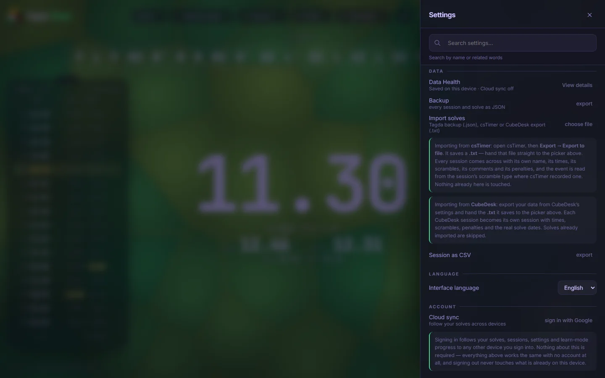

- Per-session CSV export, and the Statistics drawer's *Download selected stats*.
- **csTimer and CubeDesk import**: one picker takes a Tagda backup (`.json`), a csTimer
  export or a CubeDesk export (`.txt`) and works out which it is from the contents, because
  both write JSON into a `.txt`, so the file extension cannot be trusted. A CubeDesk session
  becomes its own session, with the real solve dates, and importing the same file twice adds
  nothing. Every csTimer session comes
  across with its name, times, scrambles, comments and penalties, and the event is read
  from the session's scramble type. Tested at ~12,000 solves across 23 sessions in under
  five seconds.

### Sync
**Sign in with Google** (the person icon in the top bar) and your solves, sessions and
settings follow you across devices. The first sign-in on a device asks once whether to
merge what is already there. A deleted solve stays deleted everywhere, instead of coming
back from another device. One username is shared by your account, race rooms and the SOTD
leaderboard, and can be edited from the account box.

### Offline
A service worker (`sw.js`) keeps a copy of the app, so the site opens with no connection
at all. Solves and settings were already in IndexedDB and scrambles are generated locally,
so once the page is up, timing never needs the network.

Works offline: the timer, every trainer, the alg trainer, statistics, the reconstructor,
Cross + 1, themes, gear, import and export.

Needs a connection: race rooms, Scramble of the Day, signing in, and Spotify.

If you are signed in and offline, solves are saved locally and upload on their own
the moment the connection comes back, with no reload. Only the page, scripts, styles and
fonts are cached; database and sign-in requests always go to the network. App files are
network-first, so a new deploy is picked up on the next load instead of being stuck behind the cache.

### Gear
The **Cube** picker in the top bar (`U`) is a log of the cubes on your desk: brand and
model, the tension you set, what you lubed it with, and a dated log of what you changed
(re-lubed, tension changed, magnets, cleaned, broke).

- **The cube you mark active is tagged onto every solve you record after that.** Past
  solves are left alone. Tagging them after the fact would invent exactly the answer the
  statistics exist to give you.
- **The trend chart can be filtered to one cube**, with a dashed line wherever you logged
  a change to it, so a step in your times can be read against the change that caused it.
- The pickers are seeded from `cubes.json` and `lubes.json`, but **they are autocomplete,
  never a fixed menu**. Anything you type is kept exactly as typed.
- Deleting a cube leaves its solves alone. They really were done on it.

---

## Keyboard shortcuts

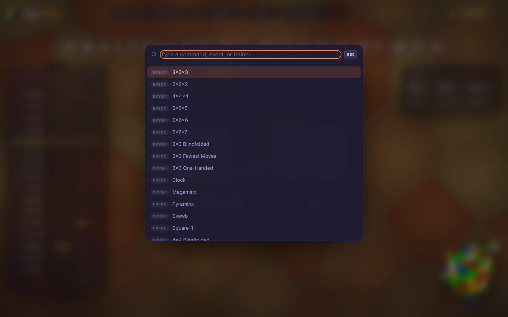

| | |
|---|---|
| **hold Space** | start / stop |
| **Esc** | cancel inspection, close any panel |
| **Delete** | delete the last solve |
| **Ctrl + Z** | undo that delete |
| **2** / **D** / **0** | +2 · DNF · clear penalty |
| **C** | comment on the last solve |
| **N** · **← →** | new scramble · previous / next scramble |
| **R** | repeat the last solve's scramble |
| **W** | watch the last solve's webcam replay |
| **Ctrl + C** | copy the scramble |
| **X** | enter your own scrambles |
| **<** / **>** | previous / next puzzle in a relay |
| **E** / **M** / **S** | event · mode · session |
| **A** / **H** | statistics · all solves |
| **T** / **,** | appearance · settings |
| **U** | gear: your cubes, lube and tension |
| **P** | Spotify |
| **B** | about |
| **K** | pick trainer cases |
| **G** | show the alg in learn mode (counts as not knowing it) |
| **Y** | reconstruct |
| **L** | Cross + 1 trainer |
| **Ctrl + K** or **/** | command palette: every event, mode, panel and share card |
| **?** | shortcut list |
| **Z** / **F** / **V** | zen mode · fullscreen · 3D↔2D preview |
| **I** | toggle inspection |
| **Ctrl + Shift + Del** | clear the whole session |

Shortcuts are ignored while you are typing in a field, and while the virtual cube is
the input, the letter keys turn the cube instead. The shortcut list and the command palette
also have buttons under **Settings → Keyboard & commands**, where the top bar's shortcuts
button moved to make room for the camera.

---

## Layout

```
index.html              the timer
algs.html               the alg trainer
admin.html              the admin console (see below)
css/tokens.css          every design value, as CSS variables
css/base.css            reset, layout, background, timer
css/components.css      panels, controls, overlays, charts
css/phone.css           the phone layout and its dock and sheets
css/recon.css           the reconstruction workbench (fetched on first open)
css/xplus1.css          the Cross + 1 trainer
css/alglibrary.css      the alg trainer page
css/announce.css        announcements
css/admin.css           the admin console
js/main.js              wiring: the entry point
js/timer.js             timer state machine + WCA inspection
js/events.js            events, modes, relay definitions
js/scramble.js          cubing.js integration, trainers, pre-generation queue
js/sidescramble.js      the Square-1 scrambler (and its worker)
js/learn.js             the learn-mode scheduler (pure, and tested)
js/learnmode.js         learn mode around it: which case next, the alg, the verdict
js/algs.js, algs2.js    trainer case tables (verified in test.html)
js/algsets.js           every OLL, PLL and ZBLL alg, all checked in test.html
js/alglibrary*.js       the alg trainer: data per set, setups, UI
js/stats.js             WCA-correct averages, BPA / WPA, grouping
js/charts.js            hand-built SVG charts
js/theme.js             settings model + live theming
js/contrast.js          auto contrast against whatever background is on screen
js/bg.js                the WebGL background shaders
js/tiles.js, drag.js    dockable panels and floating widgets
js/phoneshell.js        the phone layout: dock, Timer tab, sheets
js/cube.js              3D scramble preview
js/cubenet.js           sticker simulator and flat nets
js/cube3.js             the 3x3 model: notation, state, CFOP and Roux phase detection
js/solver.js            cross / F2L / Roux block search, last layer by simulation
js/solver.worker.js     runs that search off the main thread
js/recon.js             the reconstruction workbench
js/xplus1.js            the Cross + 1 trainer
js/fmc.js, fmcmode.js   FMC notation and the attempt flow
js/bldtrace.js          3BLD memo tracing
js/stackmat.js          Stackmat decoding over the aux jack
js/vcube.js             the virtual (keyboard) cube
js/metro.js             the floating metronome window
js/competition*.js      Competition Mode: sets, stats, whole-set replay
js/replay*.js           webcam replay: filming, the player, MP4 export
js/race*.js             race rooms and random 1v1 (race-cam.js: 1v1 cam and mic)
js/daily*.js, sotd-*.js, dayid.js   Scramble of the Day: the board, chat, replays
js/sync*.js             Google sign-in and cross-device sync
js/data-health.js       Data Health: local saves, cloud acknowledgements, recovery
js/spotify*.js          Spotify link and album theming
js/albumpalette.js      colours from album art
js/sharecard.js         share card rendering
js/gear.js              the gear log
js/panels.js            settings / stats / history / case picker drawers
js/settings-search.js   the search field in Settings and Appearance
js/palette.js           the command palette
js/i18n.js              interface language (locales/es.js is the Spanish dictionary)
js/announce*.js         announcements, news and feedback
js/admin*.js, config*.js   the admin console and the settings it controls (ADMIN.md)
js/db.js                IndexedDB
js/fx.js                confetti, shockwave, audio callouts
sw.js                   service worker (offline)
worker.js               the Cloudflare Worker: sign-in proxy, shared replays, TURN
wrangler.jsonc          the Worker's and the asset host's configuration
_headers                caching rules for the Cloudflare deploy
cubes.json, lubes.json  gear picker seeds
vendor/cubing/          mirrored cubing.js (works offline)
vendor/mediabunny/      MP4 muxing for saved replay videos
tools/                  cubing.js mirror, alg library build and verification, rules checks
serve.py                no-cache dev server
start.bat               double-click launcher
test.html               self test: open it in a browser to run it
firebase.rules.json     database rules for race rooms, SOTD, sync and the admin console
docs/                   verification write-ups and the README's screenshots
```

Deeper write-ups: [RACE.md](RACE.md) · [DAILY.md](DAILY.md) · [ADMIN.md](ADMIN.md) ·
[SPOTIFY.md](SPOTIFY.md) · [CROSSPLUS1.md](CROSSPLUS1.md) · [ALGLIBRARY.md](ALGLIBRARY.md) ·
[LASTSLOT.md](LASTSLOT.md) · [RECONSTRUCTION_ROUX.md](RECONSTRUCTION_ROUX.md) ·
[BLIND_WORKFLOW.md](BLIND_WORKFLOW.md) · [PLAN.md](PLAN.md) ·
[Competition Mode](docs/competition-mode.md)

Screenshots in `docs/screenshots/` are taken from the running app, on its *Cells* background.

---

## Deploying

The timer itself is a plain static site: no build step, no environment variables. The
live site (tagdatimer.me) runs on **Cloudflare Workers** (`wrangler.jsonc`), which serves the
repo root as static assets, which are not metered, and runs `worker.js` for only three paths:
`/__/auth/*` (the same-origin sign-in proxy, below), `/replay/*` (shared Scramble of the Day
replays, kept in R2 for 8 days) and `/turn` (relay credentials for a 1v1's cam and mic). It
also runs once a minute to apply the admin console's scheduled changes. Pushing to `main`
deploys it through Cloudflare's Git integration, or by hand:

```bash
npx wrangler deploy
```

`_headers` sets the caching that matters: `vendor/` and the fonts are cached for a year,
`sw.js` is never cached, and `js/`, `css/` and `index.html` are revalidated on every load, so a
deploy can never leave a visitor with half the old app and half the new one. `.assetsignore`
keeps `worker.js`, the package files, `sync-test.html` (a developer page that writes to
whatever database the browser opening it is signed in to) and the Vercel mover out of the public
assets.

One-time setup, none of it in the repo: an R2 bucket named `tagda-replays` with a rule that
deletes objects after 8 days and no public access; the Worker secrets `TURN_KEY_ID` and
`TURN_KEY_TOKEN` (Cloudflare Realtime TURN, without them 1v1 cam and mic fall back to STUN
alone) and `FIREBASE_SERVICE_ACCOUNT` (so the scheduler can write); and `firebase.rules.json`,
which is **published by hand** in the Firebase console, so a merged rules change is not live
until someone publishes it. Stay on the Workers Free plan: its daily request cap is part of
what keeps R2 free. [ADMIN.md](ADMIN.md) and [DAILY.md](DAILY.md) have the details.

### The old tagdatimer.vercel.app

The app now lives on Cloudflare at tagdatimer.me. The Vercel project serves only
`vercel-mover/` (set **Root Directory** to `vercel-mover` in the project's
settings): one page that reads the old origin's IndexedDB, carries it to
tagdatimer.me in the URL fragment (`js/moved.js` merges it in), and retires the
old service worker so the browser stops calling Vercel. A history too long for a
URL gets a one-click button instead. `.assetsignore` keeps the folder off
Cloudflare.

Any static host can serve the timer, trainers and offline mode, and the `.nojekyll` file stops
Jekyll from touching anything on GitHub Pages. Sign-in on a custom domain, shared replays and
1v1 cam relay need the Worker or something that does its job.

### Sign-in and the `/__/auth/*` proxy

Google sign-in normally opens a popup, and that popup reports its result back to
the page through a hidden iframe on Firebase's `authDomain`
(`tagda-timer.firebaseapp.com`). When the app is served from any other domain, that
iframe is third-party, so browsers that partition third-party storage by default
(Firefox strict mode, and therefore Zen; Safari's ITP) block the message. The
popup opens, Google signs you in, and the result never reaches the page. The only
way around that is a full-page redirect out to Google and back, which tears down the
running timer.

The fix is to stop being third-party. The Worker proxies `/__/auth/*` to the
firebaseapp.com handler (`vercel.json` still carries the same rewrite for Vercel), so the
iframe and the popup are served from the app's own origin and there is no partitioned
storage left to block. Two things have to
line up for that, and sign-in breaks outright if only one of them does:

1. `SAME_ORIGIN_AUTH_HOSTS` in `js/raceapp.js` lists the hosts that actually
   have the proxy. Anywhere else (localhost, a preview URL, a fork on another
   host), `/__/auth/*` is a 404, so those keep the firebaseapp.com
   default and fall back to the redirect flow.
2. Each host in that list needs `https://<host>/__/auth/handler` added to the
   **Authorized redirect URIs** of the project's OAuth client (Google Cloud
   Console → APIs & Services → Credentials → "Web client (auto created by Google
   Service)"), *and* the host itself in Firebase Console → Authentication →
   Settings → Authorized domains. Without the first, Google refuses the sign-in
   with `redirect_uri_mismatch`.

Deploying to a new domain therefore means editing `SAME_ORIGIN_AUTH_HOSTS`, both
console lists, and, on a host that is not Cloudflare or Vercel, porting the proxy to that
host's own config.

Solves and settings live in IndexedDB, which the browser keys by origin, so
`tagdatimer.me` starts empty for someone who has only ever used
`tagdatimer.vercel.app`. Signing in on the new domain pulls synced solves back;
anything unsynced has to come across as a Settings → backup export and import.
That is why the old domain serves the mover page instead of just redirecting.

Whatever the host, it must serve the whole folder (`vendor/` included) with
JavaScript files as `text/javascript`. Every host above does that by default.

### Admin console
**tagdatimer.me/admin** is a page for the site's admins: the app's settings, changed from a
phone, with every change logged and undoable. An admin is a Google account listed under
`admins/` in the database, added by hand in the Firebase console; everybody else who opens the
page is told it is for the site's admins, and the database rules refuse their writes anyway. It
installs to the home screen as its own app, and the service worker never serves it from cache.
From it you can switch shared replays, either chat or new race rooms off with a message for
people while they are off, tighten their limits (never past the free-tier ceilings in the code),
ban an account from posting, sharing and submitting, make every open tab reload onto a new
deploy once its timer is idle, moderate every chat, report, flagged time and shared replay of the
day, write announcements (a popup, a card or a pill) with an audience, a schedule and their
own numbers, see the day's numbers on one screen, turn a feature on for testers first, schedule a
change for later, and set a day's scramble and featured event ahead of time. How to turn it on, what each setting does and where it is
enforced: [ADMIN.md](ADMIN.md).

---

## Not in this version

Bluetooth smart cubes and Bluetooth smart timers.

Fewest Moves has no NISS helper, insertion finder or skeleton tools. It gives you the
clock, the box, the move count and an honest verdict; the thinking is yours. It is also
deliberately stricter than a judge about brackets: `(R U)` is refused, not read
as `R U`, because in a typed box a bracket means NISS or an insertion, and the moves
inside one are not necessarily the moves you performed, in the order you performed them.
FMC is excluded from race rooms and the Scramble of the Day, and it has no Stackmat or
typed-result input.

The reconstructor suggests and animates, but it cannot know what you actually turned.
Without a smart cube it removes the typing, not the remembering. It reads CFOP and Roux; ZZ
and freestyle solves will not split into phases cleanly, and it says so rather than guessing.

---

## License

The source is published so it can be read, but it is **not open source**: Tagda Timer and
[tagdatimer.me](https://tagdatimer.me/) are proprietary. You may read the code, use the site, and
open issues or pull requests; see [LICENSE](LICENSE) for exactly what else is and is not allowed.
Security reports: [SECURITY.md](SECURITY.md).
